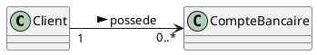
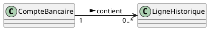
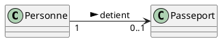

# Lire cardinalité diagramme de classe

## Remarque 
Se tromper dans la lecture d'un diagramme de classe UML est un des pièges les plus classiques en UML (et en modélisation de données) : on lit souvent la cardinalité du mauvais côté parce qu'on inverse mentalement le sujet et la cible.

### 1. Exemples simples pour bien lire les cardinalités

En UML, on parle de **multiplicité** (souvent appelée *cardinalité* par habitude). La règle d'or est : **la multiplicité placée près d'une classe B indique combien d'instances de B peuvent être liées à une seule instance de A**.

#### Exemple 1 : Un client et ses comptes bancaires (`1` vers `0..*`)

Imagine une relation entre `Client` et `CompteBancaire` :



* **À côté de `CompteBancaire` :** `0..*` (ou `*`).
* *Lecture :* **un** `Client` peut posséder **0, 1 ou plusieurs** `CompteBancaire` (un nouveau client peut n'avoir aucun compte actif, ou en avoir un courant et un épargne).


* **À côté de `Client` :** `1`.
* *Lecture :* **un** `CompteBancaire` appartient à **1 seul** `Client` (dans ton cahier des charges TP Bank).


#### Exemple 2 : Un compte bancaire et ses lignes d'historique (`1` vers `0..*`)


* **À côté de `LigneHistorique` :** `0..*`.
* *Lecture :* **un** `CompteBancaire` peut avoir **0, 1 ou plusieurs** `LigneHistorique` (un compte qui vient d'ouvrir n'a aucune opération).


* **À côté de `CompteBancaire` :** `1`.
* *Lecture :* **une** `LigneHistorique` appartient à **1 seul** `CompteBancaire`.


#### Exemple 3 : Un passeport et une personne (`1` vers `0..1`)


* **À côté de `Passeport` :** `0..1`.
* *Lecture :* **une** `Personne` possède **0 ou 1** `Passeport` valide.


* **À côté de `Personne` :** `1`.
* *Lecture :* **un** `Passeport` est rattaché à **1** `Personne`.


#### Exemple 4 : Un étudiant et des cours (`0..*` vers `0..*`)

````plantuml
@startuml
skinparam classAttributeIconSize 0
left to right direction

class Etudiant
class Cours

Etudiant "0..*" -- "0..*" Cours : suit >
@enduml
````
* **À côté de `Cours` :** `0..*`.
* *Lecture :* **un** `Etudiant` peut suivre **0 à plusieurs** `Cours`.


* **À côté de `Etudiant` :** `0..*`.
* *Lecture :* **un** `Cours` peut être suivi par **0 à plusieurs** `Etudiant`.


### 2. Moyen mémotechnique pour ne plus se tromper

Utilise la phrase à trous suivante en **fixant d'abord la classe éloignée** :

> **« Pour UN(E) [Classe A], je peux avoir [multiplicité écrite près de Classe B] [Classe B]. »**

Concrètement, si tu as un trait entre `Client` et `CompteBancaire`, et que tu regardes le chiffre **`0..*`** écrit juste à côté de `CompteBancaire` :

1. Pars de l'autre classe (`Client`) au singulier : *« Pour **un** `Client`... »*
2. Lis la multiplicité juste en face : *« ...je peux avoir **0..***... »*
3. Termine par la classe où se trouve le chiffre : *« ...`CompteBancaire`. »*

**Astuce complémentaire ("Le piège de la traversée") :**
Beaucoup d'étudiants lisent *« Un `CompteBancaire` a `0..*` `Client` »* parce que `0..*` est écrit à droite. En réalité, la multiplicité est **une propriété de l'extrémité où elle est posée** : elle compte combien d'objets de *cette extrémité-là* sont associés à *un* objet de l'autre extrémité.

### Test rapide pour vérifier le réflexe

````plantuml
@startuml
skinparam classAttributeIconSize 0
left to right direction

class Commande
class Produit

Commande "0..*" -- "1..*" Produit : concerne >
@enduml
````

Sur une relation entre `Commande` et `Produit`, tu vois **`1..*`** écrit juste à côté de `Produit`, et **`0..*`** écrit juste à côté de `Commande`.

* Que signifie le **`1..*`** près de `Produit` ?